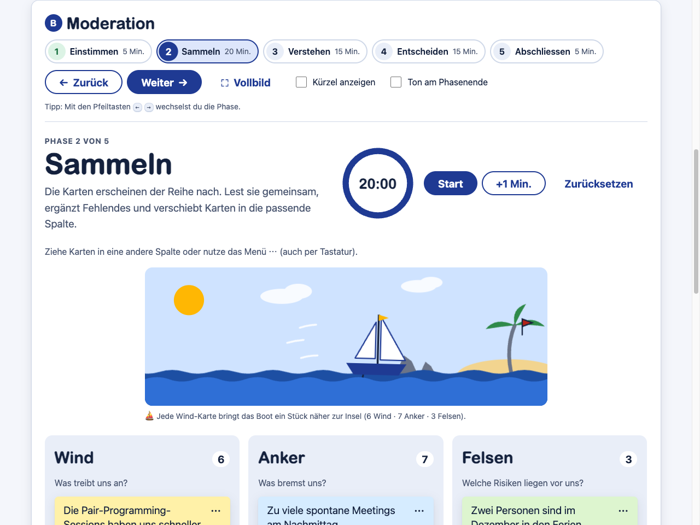
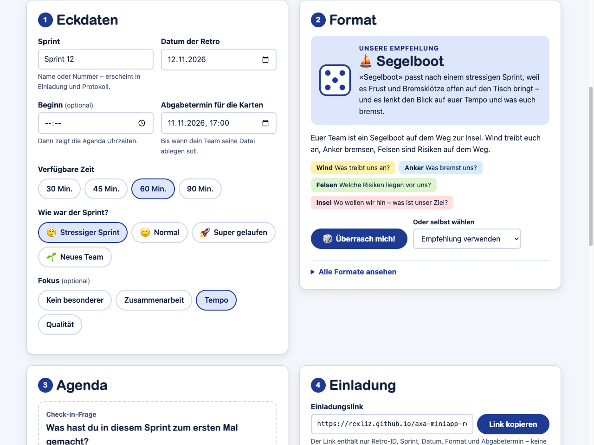

# RetroLos! – Retros leicht gemacht

Mini-App für Scrum Master und Scrum-Teams: Retro planen, Karten des Teams sammeln, moderieren und ein Protokoll erzeugen – **ohne Server, ohne Login, ohne Kundendaten**.

**▶ Live:** https://rexliz.github.io/axa-miniapp-retrolos/

> Hackathon-Prototyp eines ZHAW-Teams (AXA-Hackathon 2026, Gruppe «AXA Mini Apps», Plattform «AXALos! – Dein Mini-App Coach»). Beispiel-App für **Lösung 1 «Solo Workout»**: Mini-Apps ohne Kundendaten, selbst gebaut und über GitHub Pages bereitgestellt. Steckbrief für die Mini-App-Liste: [miniapp.md](miniapp.md).



## Problem

Am Ende jedes Sprints schaut ein Scrum-Team in der Retrospektive auf seine Zusammenarbeit zurück und legt 1–3 Massnahmen fest. In der Praxis kostet die Vorbereitung Zeit, viele Teams nutzen aus Bequemlichkeit immer dasselbe Format, und Massnahmen gehen nach der Retro vergessen.

## Lösung

RetroLos! schlägt ein passendes Format vor, erstellt die Agenda und einen Einladungslink. Das Team schreibt seine Karten zeitversetzt auf dem eigenen Gerät und gibt sie als Textdatei ab. Der Scrum Master importiert alle Dateien und moderiert per Bildschirm-Teilen in Teams. Am Ende entsteht ein Protokoll, das bei der nächsten Retro wieder importiert wird – so gehen offene Massnahmen nicht verloren.

## Ablauf in 4 Schritten

| | Schritt | Wer | Wo |
|---|---|---|---|
| 1 | **Planen:** Sprint, Zeit und Stimmung wählen → Format-Empfehlung (oder «Überrasch mich!»), Agenda, Einladungslink und Teams-Text | Scrum Master | [Planen](https://rexliz.github.io/axa-miniapp-retrolos/planen.html) |
| 2 | **Beiträge sammeln:** Link öffnen, Wetter wählen, Karten schreiben, «Meine Karten als .md speichern», Datei in den Teams-Kanal legen | jedes Teammitglied | Teilnehmen (über den Link) |
| 3 | **Importieren und moderieren:** alle Dateien hineinziehen, Bildschirm teilen, durch die 5 Phasen führen (Einstimmen, Sammeln, Verstehen, Entscheiden, Abschliessen) | Scrum Master | [Moderieren](https://rexliz.github.io/axa-miniapp-retrolos/moderieren.html) |
| 4 | **Protokoll:** als `.md` speichern, im Teams-Ordner ablegen, bei der nächsten Retro beim Planen wieder importieren | Scrum Master | Moderieren → Planen |



## Funktionen

- **Planen:** 6 Formate (Start/Stop/Continue, Mad/Sad/Glad, 4L, Segelboot, Seestern, KALM), Empfehlung nach Stimmung und Fokus mit Begründung, Würfel «Überrasch mich!», Agenda nach 10/30/25/25/10 % (anpassbar, Druckansicht), 15 Check-in-Fragen, Einladungslink und -text zum Kopieren, Import des letzten Protokolls mit «Umgesetzt? Ja / Teilweise / Nein».
- **Teilnehmen:** Check-in-Wetter, Karten schreiben/bearbeiten/löschen, Segelboot-Szene, Entwurf im Browser, Vorschau der Datei vor dem Speichern, Anleitung und Danke-Animation.
- **Moderieren:** Mehrfach-Import (Auswahl, Drag & Drop, Ordner) mit Bericht, Phasen-Stepper (auch mit ← →), Timer-Ring, Wetter-Auswertung, Karten-Einblendung, Drag & Drop und Tastaturmenü, Gruppieren, Punkte mit animierter Sortierung, Massnahmen, Feedback 1–5, Konfetti, Vollbild.
- **Abschluss:** Protokoll als `.md`, «Für Teams-Chat kopieren», Druckansicht, «Alle Daten in diesem Browser löschen».
- **Datenschutz-Wächter:** Hinweis bei E-Mail-Adressen, Telefonnummern, IBAN, AHV-Nummern und langen Nummern (Policen, Schadenfälle).

## Lokal starten

`index.html` im Browser öffnen (Doppelklick). Es braucht keine Installation, keinen Server und keinen Build. Einladungslinks zeigen dann trotzdem auf die Live-Version, damit das Team sie öffnen kann.

**Tests** (Node ≥ 22, keine Abhängigkeiten, laufen auch vor jedem Deploy):

```sh
node --test "tests/*.test.js"
```

## Struktur

```
index.html  planen.html  teilnehmen.html  moderieren.html   Seiten (flach im Root)
styles.css  planen.css  teilnehmen.css  moderieren.css      Design-Tokens hell/dunkel + Seiten-Styles
config.js                 Formate, Stimmung → Format, Check-in-Fragen, Texte  ← hier anpassen
core-plan.js              Agenda, Empfehlung, Retro-ID, Einladungslink        ┐
core-markdown.js          Dateiformat lesen/schreiben (eigener Parser)        │ ohne DOM,
core-board.js             Import-Regeln, Zusammenführen, Protokoll, Teams     │ in Node getestet
core-privacy.js           Datenschutz-Muster                                  ┘
ui.js  effects.js         gemeinsame UI-Helfer, Würfel, Konfetti, Segelboot
index.js planen.js teilnehmen.js moderieren.js   Oberfläche der Seiten
tests/                    node --test (Logik, Dateiformat, Import-Regeln, Datenschutz, Seiten)
docs/                     Dateiformat, Entscheidungen, Template-Feedback, Demo-Skript, Beispiele
specs/                    eine Spec pro Phase (Akzeptanzkriterien)
miniapp.md                Steckbrief für die Mini-App-Liste
```

Technik: HTML, CSS und Vanilla JavaScript ohne Framework und ohne Build. Klassische Scripts mit `defer` (keine ES-Module), damit die App auch direkt als Datei läuft. Content-Security-Policy `default-src 'self'`: keine externen Anfragen, keine CDNs, keine Webfonts von aussen.

## Wie füge ich ein neues Retro-Format hinzu?

Nur [`config.js`](config.js) ändern – sonst nichts:

1. Im Array `formats` einen Block nach dem Muster der bestehenden Formate einfügen:

   ```js
   {
     key: 'zeitstrahl',                 // Kleinbuchstaben und Bindestriche, nie mehr ändern
     name: 'Zeitstrahl',
     explanation: 'Das Team ordnet die Ereignisse des Sprints auf einem Zeitstrahl.',
     fitsWhen: 'nach langen oder ereignisreichen Sprints',
     focus: ['zusammenarbeit'],         // passt zu welchem Fokus (zusammenarbeit, tempo, qualitaet)
     theme: { emoji: '🕰️' },
     columns: [                         // 2–6 Spalten
       { key: 'hoch', name: 'Hochs', question: 'Was lief besonders gut?' },
       { key: 'tief', name: 'Tiefs', question: 'Wo hat es gehakt?' },
     ],
   },
   ```

2. Optional unter `moods` das Format einer Stimmung zuordnen (`formats: [...]`).
3. `node --test "tests/*.test.js"` ausführen – der Konfigurationstest prüft Schlüssel, Spalten und Zuordnungen.

Das neue Format erscheint danach in der Auswahl, in der Format-Bibliothek, bei «Überrasch mich!», im Teilnahmemodus und auf dem Board.

## Datenschutz-Prinzip

- **Keine Kunden- oder Personendaten.** Ein Banner auf jeder Seite erinnert daran. Beiträge sind standardmässig anonym; ein Kürzel ist freiwillig und erscheint auf dem Board nur, wenn der Scrum Master es einschaltet.
- **Kein Server, kein Login, kein Tracking, keine externen Anfragen.** Die App speichert nur im Browser (`localStorage`, alle Zugriffe abgesichert – sie läuft auch ohne). Dateien entstehen erst, wenn du sie selbst speicherst. Der Einladungslink trägt seine Daten im Hash (`#einladung=…`), der nie an einen Server geht.
- **Retro-Dateien gehören in den Teams-Ordner, nie ins Repo.** Repository und Website sind öffentlich, das Feedback des Teams ist intern. Die `.gitignore` schliesst deshalb `retro-*.md` und den Ordner `retros/` aus. Einzige Ausnahme sind die fiktiven Beispiele unter [`docs/beispiele/`](docs/beispiele/).
- **Der Datenschutz-Wächter ist ein Hinweis, kein vollständiger Schutz.** Er erkennt einfache Muster (E-Mail, Telefon, IBAN, AHV-Nummer, lange Nummern), aber keine Namen und keine umschriebenen Kundendaten. Er blockiert nichts – die Verantwortung bleibt bei den Menschen, die schreiben.

## Grenzen des Prototyps

- Keine Live-Zusammenarbeit: Der Austausch läuft zeitversetzt über Dateien.
- Das Board lebt im Browser des Scrum Masters. Anderes Gerät oder gelöschte Browserdaten = Board weg – deshalb am Ende das Protokoll speichern.
- **Anonymität mit Grenzen:** Auf dem Board sind Beiträge anonym, aber wer eine Datei im Teams-Kanal hochlädt, ist dort als Absender sichtbar.
- Punkte vergibt der Scrum Master nach Zuruf; es gibt kein geheimes Dot-Voting pro Person.
- «Ordner wählen» gibt es nur auf dem Desktop; am Handy steht die normale Dateiauswahl zur Verfügung.
- Automatisch getestet in Chrome (Desktop und Handy-Breite, hell und dunkel). In Edge (gleiche Engine) sollte alles gleich laufen; Firefox und Safari sind nicht automatisch getestet. Im Zweifel die Live-Version statt der lokalen Datei nutzen.
- Ohne JavaScript zeigen alle Seiten Erklärung und Ablauf, die Werkzeuge selbst brauchen JavaScript.

## Weitere Dokumentation

| Dokument | Inhalt |
|---|---|
| [docs/dateiformat.md](docs/dateiformat.md) | Spezifikation des Markdown-Formats mit Beispielen und Import-Regeln |
| [docs/demo-skript.md](docs/demo-skript.md) | 3-Minuten-Live-Demo mit Sprechtext |
| [docs/entscheidungen.md](docs/entscheidungen.md) | alle kleineren Entscheide mit Begründung |
| [docs/template-feedback.md](docs/template-feedback.md) | Erfahrungen aus dem ersten Praxistest des Templates |
| [specs/](specs/) | Akzeptanzkriterien pro Phase |
| [AGENTS.md](AGENTS.md) · [CLAUDE.md](CLAUDE.md) | Regeln für Menschen und KI-Assistenten |

Gebaut auf Stefans Template für statische Seiten auf GitHub Pages (unveränderter Stand: Commit `fdcb416`).
