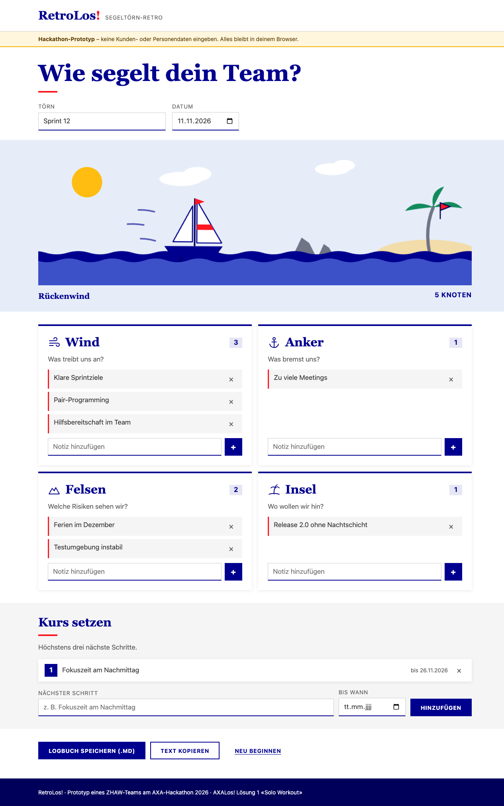

# RetroLos! – Segeltörn-Retro

Eine schmale Mini-App für die persönliche Retro als Segeltörn: **Wind, Anker, Felsen, Insel** – und bis zu drei nächste Schritte. Eine Person, ein Gerät, keine Daten auf einem Server.

**▶ Live:** https://rexliz.github.io/axa-miniapp-retrolos/

> Hackathon-Prototyp eines ZHAW-Teams (AXA-Hackathon 2026, Plattform «AXALos!»), **Lösung 1 «Solo Workout»**. Steckbrief: [miniapp.md](miniapp.md).



## So funktioniert's

1. Notizen in die vier Zonen schreiben: **Wind** (was treibt uns an?), **Anker** (was bremst?), **Felsen** (Risiken), **Insel** (Ziel). Das Boot segelt mit jeder Wind-Notiz weiter, Anker bremsen, Felsen tauchen auf.
2. **Kurs setzen:** höchstens drei nächste Schritte, optional mit Termin.
3. **Logbuch speichern (.md)** oder **Text kopieren** – z. B. für Teams, OneNote oder eine Mail.

Alles wird automatisch im Browser gespeichert. «Neu beginnen» löscht den Stand.

## Lokal starten und testen

`index.html` im Browser öffnen – kein Server, keine Installation. Tests (Node ≥ 22, ohne Abhängigkeiten, laufen auch vor jedem Deploy):

```sh
node --test "tests/*.test.js"
```

## Struktur

```
index.html          die einzige Seite (Zonen im HTML)
styles.css          Design-Tokens (AXA-Look: Tiefblau, Rot als Akzent, hell/dunkel)
core-segelboot.js   Logik ohne DOM: Zonen, Kurs des Boots, Markdown, Kurztext
core-privacy.js     Datenschutz-Muster (E-Mail, Telefon, IBAN, AHV, lange Nummern)
ui.js  effects.js   UI-Helfer, Segelboot-Szene (SVG), Konfetti
app.js              Oberfläche
tests/              node --test
```

## Datenschutz-Prinzip

- **Keine Kunden- oder Personendaten.** Ein Banner erinnert daran; der Datenschutz-Wächter zeigt einen Hinweis bei E-Mail-Adressen, Telefonnummern, IBAN, AHV- und langen Nummern. **Das ist ein Hinweis, kein vollständiger Schutz** – Namen erkennt er nicht.
- **Single-User, kein Server, kein Teilen.** Keine Sessions, keine Links, kein Login, kein Tracking, keine externen Anfragen (CSP `default-src 'self'`). Daten bleiben im `localStorage` dieses Browsers.
- **Logbücher gehören nie ins Repo.** Die `.gitignore` schliesst `retro-*.md` und `retros/` aus.

## Grenzen des Prototyps

- Nur ein Gerät: Browserdaten löschen = Törn weg; vorher das Logbuch speichern.
- Gespeicherte Logbücher lassen sich nicht wieder einlesen.
- Automatisch getestet in Chrome (Desktop, Handy-Breite, hell/dunkel).

## Doku

[docs/entscheidungen.md](docs/entscheidungen.md) · [docs/template-feedback.md](docs/template-feedback.md) · [specs/](specs/) · [AGENTS.md](AGENTS.md) · [CLAUDE.md](CLAUDE.md)
